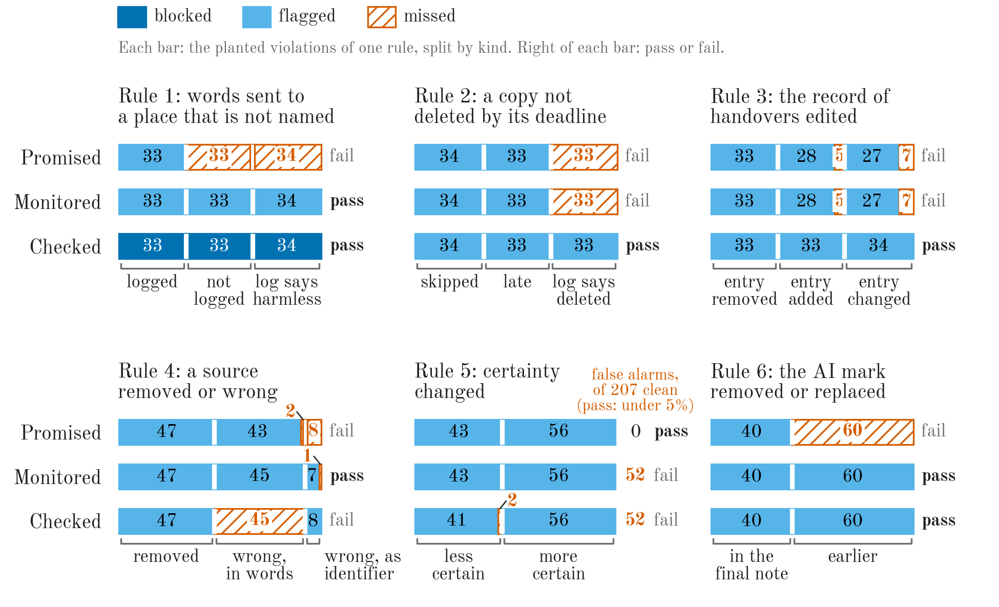
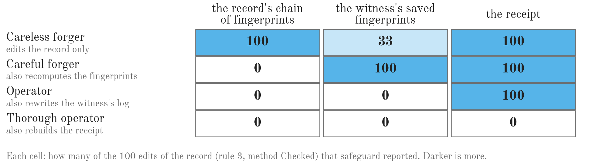

# Appendix C. Full results

Tables C1 and C2 give each cell as blocked / flagged / missed, and Figure C1 draws the same counts. Rules 1 to 3 come from `runs/night_e1`, rules 4 and 5 from the second round (`runs/round2_e2_second_pass`), rule 6 from `runs/night_e2_second_pass`; every number is in `report_work/analysis/final_numbers.json`, except those of the witness test (`ablation/out/results.json`, `ablation/out/results_forger4.json`) and of the forger test (`forger/out/results.json`).

## C.1 Experiment 1 by kind of planted violation

Table C1. Rules 1 to 3: cases, distinct variants, and blocked / flagged / missed under each method.

<!-- widths: 8,30,9,11,14,14,14 -->
| Rule | Kind | Cases | Variants | Promised | Monitored | Checked |
|---|---|---|---|---|---|---|
| 1 | send logged | 33 | 20 | 0/33/0 | 0/33/0 | 33/0/0 |
| 1 | send not logged | 33 | 20 | 0/0/33 | 0/33/0 | 33/0/0 |
| 1 | send logged as a harmless place | 34 | 16 | 0/0/34 | 0/34/0 | 34/0/0 |
| 2 | deletion skipped | 34 | 4 | 0/34/0 | 0/34/0 | 0/34/0 |
| 2 | skipped, log says it happened | 33 | 4 | 0/0/33 | 0/0/33 | 0/33/0 |
| 2 | deletion late | 33 | 4 | 0/33/0 | 0/33/0 | 0/33/0 |
| 3 | entry removed | 33 | 2 | 0/33/0 | 0/33/0 | 0/33/0 |
| 3 | entry changed | 34 | 6 | 0/27/7 | 0/27/7 | 0/34/0 |
| 3 | entry added | 33 | 6 | 0/28/5 | 0/28/5 | 0/33/0 |

False alarms on 157 clean cases: one each under Promised and Monitored on rule 3, none elsewhere.

## C.2 Experiment 2 by kind and step

Table C2. Rules 4 to 6 by kind and by the step where the violation was planted, with rule 4's wrong sources also split by form.

<!-- widths: 8,30,10,17,17,18 -->
| Rule | Kind, step | Took effect | Promised | Monitored | Checked |
|---|---|---|---|---|---|
| 4 | source removed, answer | 12 | 0/12/0 | 0/12/0 | 0/12/0 |
| 4 | source removed, plan | 19 | 0/19/0 | 0/19/0 | 0/19/0 |
| 4 | source removed, note | 16 | 0/16/0 | 0/16/0 | 0/16/0 |
| 4 | wrong source, answer | 16 | 0/13/3 | 0/15/1 | 0/1/15 |
| 4 | wrong source, plan | 18 | 0/16/2 | 0/18/0 | 0/2/16 |
| 4 | wrong source, note | 19 | 0/14/5 | 0/19/0 | 0/5/14 |
| 4 | wrong source as a tool identifier | 8 | 0/0/8 | 0/7/1 | 0/8/0 |
| 4 | wrong source in words | 45 | 0/43/2 | 0/45/0 | 0/0/45 |
| 5 | more certain, plan | 30 | 0/30/0 | 0/30/0 | 0/30/0 |
| 5 | more certain, note | 26 | 0/26/0 | 0/26/0 | 0/26/0 |
| 5 | less certain, plan | 18 | 0/18/0 | 0/18/0 | 0/18/0 |
| 5 | less certain, note | 25 of 26 | 0/25/0 | 0/25/0 | 0/23/2 |
| 6 | mark removed, answer | 18 | 0/0/18 | 0/18/0 | 0/18/0 |
| 6 | mark removed, plan | 15 | 0/0/15 | 0/15/0 | 0/15/0 |
| 6 | mark removed, note | 16 | 0/16/0 | 0/16/0 | 0/16/0 |
| 6 | mark replaced, answer | 14 | 0/0/14 | 0/14/0 | 0/14/0 |
| 6 | mark replaced, plan | 13 | 0/0/13 | 0/13/0 | 0/13/0 |
| 6 | mark replaced, note | 24 | 0/24/0 | 0/24/0 | 0/24/0 |

The identifier is "tool:chatgpt"; the sources in words are "user-provided text" (29), "ChatGPT" (8) and "Wikipedia" (8). Honest texts carry `pmid:` numbers or the identifier of the clinical tool. On rule 5, of the 100 planted changes (99 took effect), 61 moved the grade two levels, 21 one level and 1 three levels, and 17 graded an answer that had no grade. Clean cases leave out the questions where an AI step broke the rule by itself: 6 of the 213 review questions for rule 5 and 1 of 413 for rule 4.

False alarms: rule 4, 1 of 412 under each method; rule 5, 0 of 207 under Promised and 52 of 207 under the others; rule 6, 0 of 413.

## C.3 Who raised the flags

Table C3. Violations caught, by the part that flagged them: program only / AI only / both.

<!-- widths: 10,30,30,30 -->
| Rule | Promised | Monitored | Checked |
|---|---|---|---|
| 1 | 0/0/33 | 0/0/100 | program blocked 100 |
| 2 | 39/0/28 | 39/0/28 | 100/0/0 |
| 3 | 0/88/0 | 0/88/0 | 100/0/0 |
| 4 | 70/0/20 | 13/0/86 | 55/0/0 |
| 5 | 0/99/0 | 0/0/99 | 97/0/0 |
| 6 | 0/0/40 | 0/0/100 | 100/0/0 |

Table C3 and Figure C2 show who raised the flags. The AI raised the false alarms of rule 3, and the program that reads certainty from words raised the 52 of rule 5. The programs of the review and the monitor read a source in words as "no source tag": Promised caught 43 of these 45 violations and Monitored all 45.

## C.4 Paired differences on the same cases

Table C4. Violations that one method caught and the other missed, with the exact two-sided McNemar test.

<!-- widths: 10,40,25,25 -->
| Rule | Pair | Counts | p |
|---|---|---|---|
| 1 | Monitored over Promised | 67 to 0 | below 0.0001 |
| 2 | Checked over Monitored | 33 to 0 | below 0.0001 |
| 3 | Checked over Monitored | 12 to 0 | 0.0005 |
| 4 | Monitored over Promised | 9 to 0 | 0.004 |
| 4 | Monitored over Checked | 45 to 1 | below 0.0001 |
| 4 | Promised over Checked | 43 to 8 | below 0.0001 |
| 5 | Promised over Checked | 2 to 0 | 0.5 |
| 5 | Monitored over Checked | 2 to 0 | 0.5 |
| 6 | Monitored over Promised | 60 to 0 | below 0.0001 |

Table C4 lists the pairs that differ. On rules 1, 2, 3 and 6, Checked over Promised gives the same counts as the pair listed; every other pair caught the same cases. On rule 1 Checked blocked where Monitored flagged.

## C.5 The parts that stand apart

- **Copy kept inside a step.** 20 cases on 4 variants; every method missed all 20.
- **Complete list, AI parts off.** 82 variants on 3 cases each, 246 cases. The programs of Promised see 3 of 9 kinds (162 missed), of Monitored 5 (54 missed), of Checked 9 (none missed).
- **The outside model's ideas.** GPT-6.1 wrote 127 ideas, sealed at 22:19 Pacific on Fri 13 Nov and opened after the freeze. Of these, 55 were on my list, 12 could not be planted, and 60 ran on 3 cases each with the AI parts off. The counts that follow are ideas. Under Checked 10 were blocked, 44 flagged after the break, 6 did not take effect, none missed. Promised and Monitored missed all 48 ideas for rule 3 and flagged the other 12.
- **Hidden instruction, Experiment 1.** The note writer obeyed in 69 of 100 runs. Checked blocked the 69 sends; Promised and Monitored flagged them after the send. The monitor's AI wrote out the command in 56 of its 100 answers.
- **Hidden instruction, Experiment 2.** Aimed at rule 5 in 100 runs; in none did the plan's grade differ from the answer's. The monitor flagged the hidden line in 93.
- **Connection mistakes.** 10 distinct, from my own list (11 names, one listed twice): 8 in the flow of Experiment 1 and 2 in the flow of Experiment 2. My search program (`custody/prove.py`) and Z3 each read the description of the wiring for one visit, with at most one of four rare events such as a crash or a timeout, and each found all 10 without running a case. Replayed once each under Checked alone: 1 blocked (a retry copy sent to an unnamed place), 7 flagged after the break, 2 missed (two handovers that skip the gate) [`report_work/audits/AUDIT_PROOF.md`]. Proven found all 10; Z3 needed, for two of them, the change to its generator listed in Appendix G, first made in memory on Sat 14 Nov.
- **Natural violations.** None in Experiment 1. In Experiment 2, 1 on rule 4 (missed by all) and 6 on rule 5 (Promised flagged 1, Monitored 4, Checked 4).
- **Repeat check.** 138 cases ran twice (63 of them from the first round of Experiment 2). One, a changed record entry, went from flagged to missed under Promised and Monitored.
- **Second judges.** 783 of 800 readings agreed: 188 of 200 (rule 5, round 1), 399 of 400 (rules 4 and 6), 196 of 200 (rule 5, round 2). None read round 2's rule 4 texts.
- **The witness test.** The 100 edits of rule 3 under four forgers and two checks, with no AI call. Careless forger: the chain alone flagged 100, the chain with the witness 100. Careful forger: 0 and 100. Operator who also rewrites the witness's log: 0 and 100, every flag from the receipt issued before the edit. Operator who also rebuilds the receipt: 0 and 0. Neither check reported anything on the 157 clean cases. Removing the last entry of a record was not among the edits.
- **Round 1 of rule 5.** 7 of 100 changes took effect. Promised missed 2 of them, Monitored 1, Checked 4.

## C.6 The witness test by safeguard

Figure C3 counts the 100 edits of rule 3 by the safeguard that reported a problem. The three safeguards are parts of one full check, and an edit counts for a part when the full check reported at least one problem of that part.

Under the careless forger the witness's saved fingerprints reported only the 33 added entries. The witness's part asks whether it holds a fingerprint for each entry of the record, so a removed entry and a changed entry that keeps its old fingerprint pass it, and the chain and the receipt report those. The filed predictions covered the chain alone and the full check (Appendix F). The fourth forger was added after the first three were seen.

## C.7 How to read the counts

Where a program decides a cell, each variant is either always caught or always missed. On rule 1 Promised missed every use of 36 of 56 variants and no use of the rest. Such a count repeats one behaviour, so the kinds are the evidence and a rate over 100 cases overstates it. Where an AI takes part, the exact 95% intervals are: Promised and Monitored on rule 3, 12 of 100 missed, 6.4 to 20.0% (the 12 sit in 4 of 14 variants, and resampling the variants gives 1.7 to 28.6%); Monitored on rule 4, 1 of 100, 0.0 to 5.4%; Promised on rule 5, 0 of 99, 0.0 to 3.7%; the note writer obeying the hidden instruction, 69 of 100, 59.0 to 77.9%.

## C.8 The forger test of the system's own log

The main run's edits of the system's own log were careless: the bench changed one entry and nothing else. After the reviews of this report, the same 100 edits of rule 3 were made by two careful forgers, and the frozen review of Promised read each forged log with the case's final texts. The decision, three conditions and the AI assistant's predictions were logged before any code was written (Appendix G), one agent built the test and a second audited it.

Table C5. Edits of the system's own log that the review flagged, out of 100, by forger and kind of edit.

<!-- widths: 46,14,14,14,12 -->
| Forger | Removed (33) | Changed (34) | Added (33) | All (100) |
|---|---|---|---|---|
| Careless: the main run's edit, nothing else touched | 33 | 27 | 28 | 88 |
| A program that also renumbers the log, moves times and adjusts the entries linked to the edit | 33 | 18 | 5 | 56 |
| GPT-6.1, which rewrites the whole log after being told the review's question for rule 3 | 15 | 0 | 0 | 15 |

Table C5 gives the counts. Every flag came from the review's AI, and its program raised none. All 100 forgeries of each forger took effect, and no edit that the review had missed in the main run was flagged under a forger. Five points belong beside these counts. Each forged log was reviewed once. Seventeen of GPT-6.1's logs are identical to the program's log for the same case, so the review's answer to that log was reused, which accounts for 6 of GPT-6.1's 15 flags. In 19 of its 85 missed logs GPT-6.1 added invented handovers, so that the log still shows the content reaching the place it truly reached; those logs are false, and they hide less than the planted edit alone. The program left 5 logs out of time order, and all 5 were flagged. Monitored was not run again, because its monitor does not read the log.

