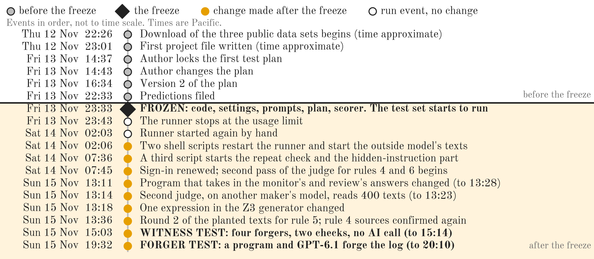

# Appendix G. Changes after the freeze

The code, the settings, the prompts, the plan of planted violations and the scorer were frozen at Fri 13 Nov, 23:33 Pacific, each with its SHA-256 fingerprint (`live_night_e1/frozen.json`). Table G1 lists every later change, and Figure G1 places them in time. Each is logged in `night/night_notes.md`, in the two audits of Sun 15 Nov (`report_work/audits/`) or, for the judge's second pass, in `rejudge/calib/CALIBRATION_NOTES.md`.

Table G1. Every change made after the freeze.

| When | What changed | Why | Could it change a reported number? | How the frozen result is kept |
|---|---|---|---|---|
| Sat 14 Nov 02:06 | Two shell scripts outside the frozen code restart the runner after a usage-limit stop (`night/chain_s.sh`) and start the outside model's texts once the clean cases are done (`night/chain_g.sh`) | At 23:43 the runner met the usage limit, did not recognise its reply and stopped | No. The audit found every planned case once under each method, none doubled, none lost | No frozen file changed |
| Sat 14 Nov 07:36 to 07:45 | The repeat check and the hidden-instruction part of Experiment 2 were started by a third script (`night/chain_one.sh`). From 07:37 every call failed with an expired sign-in, which one plain call outside the sandbox renewed at 07:45 | Running stages of the frozen plan; the sign-in expires about every 8 to 10 hours | No. Failed calls were asked again and never stored | No frozen file changed |
| Sat 14 Nov, from 07:45 | Second pass of the judge for rules 4 and 6, with corrected questions | The first question asked about the prose only, so texts with a correct source tag or AI mark counted as violations | Yes, the grades of rules 4 and 6 | Calibrated on the practice set against a condition fixed in advance; run by a separate program into new files; both keys kept (`rejudge/`) |
| Sun 15 Nov 13:11 to 13:28 | The program that takes in the answers of the monitor and the review now sets aside lines that are no flag, where it used to refuse the whole answer (`tools/run_advice.py`, `custody/ai_live.py`, `custody/score_parts.py`). Separate agents built and audited the change, and 691 tests pass | The hidden-instruction part of Experiment 1 had stopped in the night: the monitor's AI wrote out the hidden command, and the program refused such an answer | Only the hidden-instruction part of Experiment 1, which had no result before. The main table is unchanged line for line | The part ran to its end with the change declared (13:40 to 13:43) |
| Sun 15 Nov 13:14 to 13:23 | A second judge on another maker's model read 400 texts of the judge's second pass for rules 4 and 6 (`rejudge/second_judge.py`) | The outside review asked for an independent check of the corrected answer key | No. It agrees on 399 of 400 | New files only |
| Sun 15 Nov 13:18 | One expression in the Z3 generator (`model/gen_z3.py`) and a new test | The generated script crashed when a deletion aims at a place no move has filled (two connection mistakes) | No. The same change had been made in memory on Sat 14 Nov; the verdicts are the same (`report_work/audits/AUDIT_PROOF.md`) | The snapshot `night/proof/custody_z3.py` was left as it was |
| Sun 15 Nov from 13:36 | Round 2 of the planted texts for rule 5 (a target level two levels away where the scale allowed it, written by GPT-6.1 in its own words) and a corrected confirmation of 52 wrong-source texts for rule 4 (`round2/`) | Round 1's changes for rule 5 left the grade where it was in 93 of 100, by the judge's reading, and round 1's confirming program had dropped valid wrong-source texts for their form | Yes. The grades of rules 4 and 5 come from this run | New folders only (`runs/round2_e2`). The run of Sat 14 Nov is kept, and the decisions were logged before the run started |
| Sun 15 Nov 15:03 to 15:14 | The witness test (`ablation/`): four forgers against the gate's record and two checks, with no AI call. One agent built it and a second audited it | Three reviews of this report asked what the witness adds | It adds the forger results of Section 4.4 and Appendix C, part C.6, and changes no earlier number | New files only. The decision, two conditions and the predictions for the first three forgers were logged before any code was written; the fourth forger was added after their results |
| Sun 15 Nov 19:32 to 20:10 | The forger test (`forger/`): a program and GPT-6.1 forge the system's own log for the 100 edits of rule 3, and the frozen review reads the forged logs. One agent built it and a second audited it | The report said that a careful forger may leave fewer traces, without measuring it | It adds one sentence to Section 4.1 and Appendix C, part C.8, and changes no earlier number | New files only. The decision, three conditions and the predictions were logged before any code was written |

The repeat runs leave one gap: their log names call ids without the repeat's salt, so 1,017 used answers link to the store by their text only. The analysis of Sun 15 Nov also found one wrong table in the frozen scorer: the repeat check of Experiment 2 under the first answer key, where natural rows overwrite planted rows. I use the table of the second pass, which is correct.
