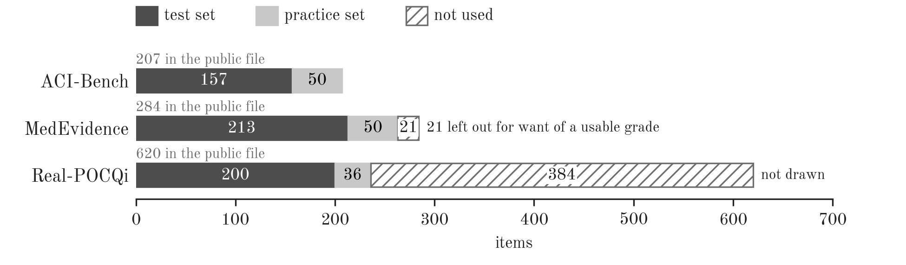
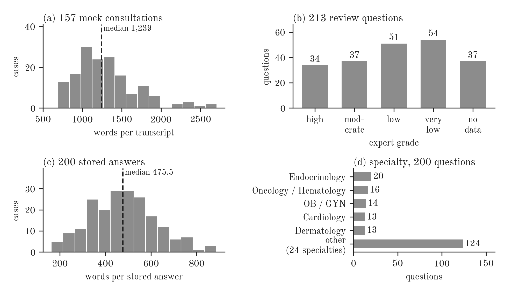

# Appendix J. Data

Tables J1 and J2 and Figures J1 and J2 describe the data. Every number here is computed by `report_work/analysis/data_appendix.py` from the data files and saved in `data_appendix_numbers.json` beside it.

## The three data sets

Table J1. The three data sets as downloaded and as used.

<!-- widths: 14,23,13,17,10,10,13 -->
| Data set | What it holds | Made by | Public file | Practice and test | Licence | Real persons |
|---|---|---|---|---|---|---|
| ACI-Bench | Doctor-patient conversations with their visit notes, made for research | ACI-Bench [@acibench] | 207 conversations in five files, all usable | 50 and 157 | CC BY 4.0 | No; the metadata hold names, which the bench does not read |
| MedEvidence | Questions from 100 systematic reviews, each with the experts' conclusion and studies, most with a certainty grade | MedEvidence [@medevidence] | 284 questions, 263 usable | 50 and 213 | MIT | No; findings about groups of patients in published studies |
| Real-POCQi | Physicians' questions put to a clinical AI tool, with stored answers from four AI systems and physicians' ratings | Real-POCQi [@realpocqi] | 620 questions, 2,480 answers and 5,780 rating rows, all questions usable | 36 and 200 | CC BY 4.0 | Real physicians' questions that the authors filtered and lightly rewrote to remove identifying details |

The downloaded MedEvidence and Real-POCQi files carry no licence, so those cells give the licence on each dataset card on Hugging Face (huggingface.co/datasets/clcp/med-evidence and huggingface.co/datasets/jjfenglab/Real-POCQi) [@medevidence; @realpocqi].

## How the cases are built

Experiment 1 uses each of the 207 ACI-Bench conversations as one case. The practice set holds the first 50 of the training file by encounter number (D2N001 to D2N050), and the test set the other 157.

Experiment 2 has 499 cases. Its 413 test cases are 213 review questions, 176 with an expert grade and 37 at the level "no data", and 200 with a stored answer. Of the 263 usable MedEvidence questions in order of number, the first 50 form the practice set. All 620 Real-POCQi questions have a stored answer from the clinical AI tool used. The practice set holds 36, those an earlier joined list of visits (retired on 13 November) had placed with practice conversations, the 102nd to 137th by id sorted as text. The test set holds 200 drawn by lot from the other 584 with `random.Random(20261119).sample` over the ids sorted as text, and the script repeats the draw exactly.

No conversation or question sits in both sets, though one review supplies graded questions to both. The run files show that every test case ran in the scored runs and no practice case did. The transcripts, questions and stored answers match the downloaded files word for word, and the incoming answers for review questions are built in fixed wording (Appendix B).

## What was left out

No ACI-Bench conversation was left out, and its metadata on doctor and patient are not read. Of the 284 MedEvidence questions, 21 have no grade and an answer other than "insufficient data" (10 "no difference", 7 "higher", 3 "lower", 1 "uncertain effect"), so they have no usable grade; the 37 with no grade and that answer are kept at the level "no data". From Real-POCQi, 384 questions were not drawn, and the 1,860 answers of the other three systems and the 5,780 rating rows are unused.

## What the data looks like

Table J2. The test set's cases.

<!-- widths: 40,60 -->
| Measure | Value |
|---|---|
| Words per transcript (157) | median 1,239; range 693 to 2,707 |
| Lines per transcript, one speaker turn per line | median 48; range 7 to 136 |
| Lines by speaker tag | doctor 4,375; patient 3,993; patient guest 132; no tag 8 |
| Grade level of the review questions (213) | high 34; moderate 37; low 51; very low 54; no data 37 |
| Studies per graded question | median 2; range 1 to 10 |
| Words per stored answer (200) | median 475.5; range 162 to 887 |
| Words per stored-answer question | median 13; range 2 to 74 |
| Specialty of the stored-answer questions | Endocrinology 20; Oncology / Hematology 16; OB / GYN 14; Cardiology 13; Dermatology 13; other 124 (24 specialties) |

Words are counted between spaces, speaker tags included. The files mark speakers by line, so lines stand in for turns.

## Limits of this data

The conversations were made for research and enter as text, so the results say nothing about copies of recordings; the files do not say how the conversations were spoken, and the README notes speaker tags from speech recognition left uncorrected. The graded questions come from published reviews, so rule 5 is tested only on certainty that a program states in fixed wording from the reviews' grades. The stored answers come from one clinical AI tool, so the tests of rules 4 and 6 meet one tool's style of answer. All three sets are in English, and the 213 test questions from systematic reviews come from 74 reviews, so questions from one review are related cases.

The counts behind every cell of the results table are in Appendix C.
